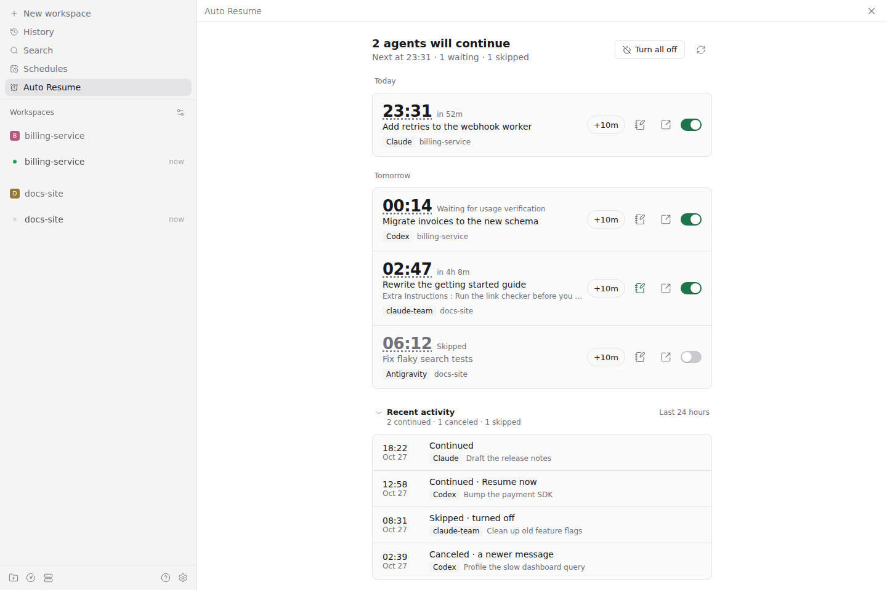
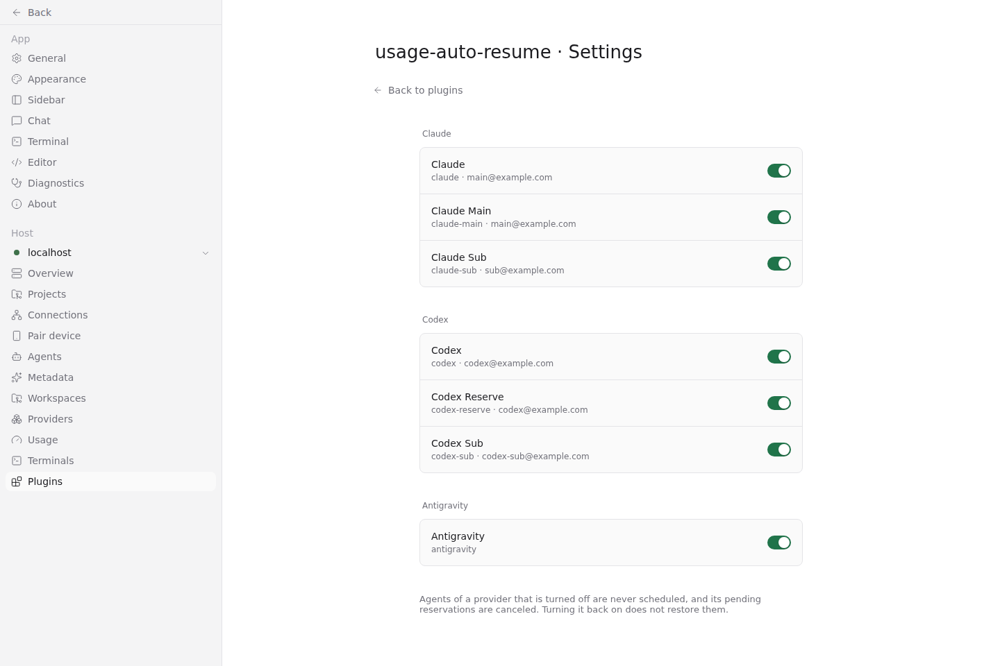

# Usage Auto Resume

[English](README.md) · [MIT 라이선스](LICENSE)

별도 데모 환경에서 샘플 예약을 사용해 실제 Paseo 웹 화면을 촬영했다.





Codex, Claude 또는 Antigravity agent가 usage/rate limit으로 멈추면 reset 시각 + 2분에 **같은 agent**에 continue prompt를 한 번 보내는 Paseo plugin이다. 새 agent 생성, provider 전환은 없다.

## Auto Resume 화면

사이드바(☰) 위쪽 목록의 **Auto Resume**에서 예정된 자동 재개를 날짜별로 본다. 각 행은 전송 시각, 남은 시간, agent 제목, provider, project/workspace를 보여 준다. 행의 열기 버튼을 누르면 그 agent 대화가 열린다.

- 모든 예약은 켜진 상태로 생긴다. 필요 없는 것만 스위치로 끈다. 저장 버튼 없이 바로 적용된다.
- 끈 예약은 예정 시각까지 목록에 남아 다시 켤 수 있다. 예정 시각이 지나면 보내지 않고 목록에서 사라진다. 그 전에 agent에게 직접 메시지를 보내도 사라진다.
- **+10m**을 누르면 10분 뒤로 미룬다. 시각을 누르면 그 자리에서 새 시각을 입력하고 **Today**, **Tomorrow**, 또는 주간 리셋이라면 예약된 날을 고른다. 리셋 시각 + 2분보다 이르거나 일주일보다 먼 시각은 저장하지 않고 이유를 보여 준다. 꺼진 예약도 시각을 바꾸면 다시 켜진다.
- 헤더 버튼은 켜진 예약이 하나라도 있으면 모두 끄고, 없으면 모두 켠다. 화면에 보이는 예약만 바꾸며, 이미 전송 중인 예약은 그대로 둔다.
- 화면은 30초마다 새로 고친다. Desktop은 새로 고침 버튼, mobile은 당겨서 새로 고침을 쓴다.

행 구조는 iOS 시계 앱의 알람 목록을 따랐다. 스위치 사용은 [Apple HIG Toggles](https://developer.apple.com/design/human-interface-guidelines/toggles)(목록 행 안의 스위치, 행 내용이 맥락)와 [NN/g Toggle-Switch Guidelines](https://www.nngroup.com/articles/toggle-switch-guidelines/)(즉시 적용)를 따랐다. 카드·간격·스위치 규격은 Paseo 설정 화면과 같다.

## 대상

Claude, Codex, Antigravity를 실행하는 모든 provider가 대상이다. 내장 `claude`, `codex`, `antigravity`와, 이들을 `extends`하는 `claude-main`, `codex-sub` 같은 provider가 모두 포함된다. `extends` 체인을 따라 내장 provider에 닿는지로 CLI를 판단한다. 그래서 `codex`를 extends한 `codex-reserve`는 `codex`와 같은 계정을 쓰더라도 Codex 아래에 따로 나온다.

**Settings → Plugins → usage-auto-resume → Settings**는 daemon이 아는 provider를 CLI별로 나열하고, 각 provider의 ID, 로그인 계정, pending 예약 수를 보여 준다. 스위치는 누르는 즉시 저장된다. 처음에는 모든 provider가 켜져 있고, 나중에 Paseo에 추가한 provider도 켜진 상태로 시작한다. Provider를 끄면 그 agent는 예약되지 않고, 이미 있는 pending 예약도 취소한다. Auto Resume 목록에서 꺼 둔 예약도 여기에 포함된다. 다시 켜도 취소한 예약은 복구하지 않는다. 다음 limit 중단부터 평소처럼 예약하며, 재시작 뒤에는 시작 scan이 최근 중단을 다시 찾을 수 있다.

설정은 daemon별 `$PASEO_HOME/plugin-settings/usage-auto-resume/providers.json`에 저장된다. CLI마다 ID 하나를 고르던 이전 설정에서 업그레이드하면 모든 provider가 켜진 상태로 시작한다. 설정을 읽지 못하면 기본값으로 전환하지 않고 자동 재개를 대기시킨다.

## 동작

1. `agent.turn_ended`의 오류 코드와 짧은 notice는 재개 **후보**로만 감지한다. workspace/AI credit·spend cap notice도 같은 한도 중단으로 다루며, API billing·context 오류는 제외한다.
2. `agent.session_open`에서 실행 경로와 인증 환경 변수의 존재 여부만 캡처한다. 실제 CLI 인증을 확인해 API·외부 과금 경로는 제외하고, 확인되지 않으면 대기한다. 저장된 OAuth 파일이나 이메일만으로 구독 인증을 확정하지 않는다.
3. Codex는 login refresh 없이 계정·설정을 조회하고 해당 workspace의 사용량을 읽는다. Claude는 `auth status --json`과 OAuth profile을 대조한 뒤 구독 사용량을 읽는다. 예약은 계정/workspace·모델에 연결되며, 대상이 바뀌면 취소된다.
4. 판단 기준은 해당 5시간/주간 창이다. 100%인 창이 있으면 그 reset + 2분에 예약하고, 여러 창이 소진되면 마지막 reset을 기다린다. Codex의 정확한 모델에 `model_usage.available_at`이 있으면 그 모델의 창으로 본다.
5. credit 소진(`Your workspace is out of credits…`)은 창을 넘어 더 쓸 수 있는지만 뜻하므로 따로 기다리지 않는다. 100%인 창이 없으면 15분, 30분, 1시간 뒤 continue를 재시도하고 그래도 막히면 중단한다. 단 notice에 아직 지나지 않은 reset이 적혀 있으면 그 시각을 기다린다. 재시도 중 100%인 창이 확인되면 그 reset을 기다리고 재시도 횟수는 처음부터 다시 센다.
6. 발송 직전에 agent 상태와 사용 가능 상태를 다시 확인한다. 새 메시지, 실행 중/closed/archive 상태, permission 대기는 취소 사유다. 사용량 조회 실패·100%인 과거 창·불명확한 인증은 15분 뒤 읽기 전용 재확인으로 미루며 **continue를 보내지 않는다.**
7. Agent당 예약 하나, crash 후 중복 전송 방지, provider별 스위치, 수동 시간 변경은 유지한다. 실제 자동 continue가 연속 24회 한도로 실패하면 중단한다. 상태 조회는 모델 재시도로 세지 않는다. 대기 행의 시각은 전송 시각이 아닌 다음 확인 시각으로 표시한다.
8. 최근 12시간의 시작 scan으로 놓친 중단도 찾는다. 플러그인 로드 전에 열린 세션은 캡처된 launch context가 없으므로 daemon 환경과 provider 설정 env로 계정을 확인한다(v1.2.0과 같은 계정 선택). 다른 플러그인이 session open 때 추가하는 값은 이 경우 보이지 않는다. 새 세션/interactive refresh로 캡처된 경로·boolean 플래그·계정/모델 hash는 job에 보존하므로 이후 plugin 재시작에도 사용할 수 있다. 토큰은 저장·로그에 남기지 않는다.

**현재 검증 범위:** agy(1.4.0)는 계정 identity를 알려주지 않고 Paseo에도 Antigravity 사용량 정보가 없어, Antigravity agent는 v1.2.0처럼 사용량 조회 없이 notice에 적힌 reset 시각을 따른다. 5시간 notice 뒤에 주간 quota가 소진된 경우는 알 수 없다. Antigravity API 경로(`GEMINI_API_KEY`, `AGY_ADC_AUTH`, `GOOGLE_GEMINI_BASE_URL`)는 계속 제외한다. Claude macOS Keychain, 다중 인자 custom launcher, 해석하지 못한 quota 형태도 대기한다.

CLI status와 OAuth profile/usage 조회는 모델 turn을 만들지 않는다. 조회 인증에 필요한 access token은 해당 CLI 저장소에서 읽지만 refresh·재저장하지 않으며, 크레딧 구매나 overage 활성화도 하지 않는다. 계정 이메일은 설정 화면의 표시용이고 자동 재개 판단은 직접 조회한 계정/조직·모델 identity를 사용한다.

### Paseo 내장 API와 감지 범위

Paseo 0.11.0의 [`agent.turn_ended`](https://paseo.sh/docs/plugins/reference)의 `outcome`은 `completed`·`failed`·`canceled`이며, `failed`만 optional `error.code`를 갖는다. 별도의 `usage_limited` 상태나 limit 전용 lifecycle event는 없다. 이번 Claude 기록처럼 한도 안내가 일반 `assistant_message`로 오고 turn이 completed로 끝날 수 있어, 코드 판정만으로는 충분하지 않다.

Paseo의 `providers.listUsage()`는 표시용으로 정규화하면서 원래 차단 사유나 모델별 readiness를 생략할 수 있다. 자동 전송 판정에는 이 목록의 이메일 매칭 대신 실제 CLI 인증과 직접 읽은 계정·모델별 상태를 사용한다. 세부 근거는 [조사 기록](docs/research/usage-limit-classification.md)을 참고한다.

Job은 `$PASEO_HOME/plugin-data/usage-auto-resume/jobs.json`(기본 `~/.paseo/...`)에 저장되어 daemon/plugin 재시작 후에도 유지된다.

## Paseo heartbeat를 쓰지 않는 이유

Paseo 0.11 plugin API(`PaseoApi`)에도 schedule/heartbeat API가 없다. Heartbeat는 CLI(`paseo heartbeat create`)로만 만들 수 있다. 또 heartbeat는 실행 시각에 prompt를 그대로 보내므로, 그 사이 수동 재개나 permission 대기를 확인할 수 없다. 그래서 [paseo-defer](https://github.com/tomgrin10/paseo-defer)의 persisted queue 방식을 public SDK 호출로 구현했다.

**제약:** Plugin은 hook/RPC 안에서만 `paseo` API를 받는다. Daemon이나 plugin을 재시작한 직후에는 첫 lifecycle hook(어느 agent든 turn 시작/종료, 생성, 종료(close), permission 요청, archive) 또는 Auto Resume 화면의 RPC 요청이 들어올 때까지 예약 실행이 대기한다. 그 시점에 이미 지난 job은 인증·사용량을 재확인한 뒤 실행 여부를 결정한다.

## 설치

GitHub에서 직접 설치할 수 있다:

```bash
paseo plugin install github:babo-jeonguk/paseo-usage-auto-resume
```

로컬 개발 설치:

```bash
cd /path/to/paseo-usage-auto-resume
npm install
npm run check
paseo plugin install "$PWD"
```

Paseo daemon과 app 모두 0.11.0 이상이어야 한다(`paseo-plugin.json`의 `>=0.11.0`). `config.json`의 root `pluginsEnabled`가 켜져 있어야 한다. 소스를 바꾼 뒤에는 `paseo plugin reload usage-auto-resume`을 실행한다. 로그는 daemon log의 `[usage-auto-resume]` 줄에 남는다.

## 로드맵

- 예정: 지원 provider 확대. Paseo usage 정보가 있으면 함께 쓴다 ([#3](https://github.com/babo-jeonguk/paseo-usage-auto-resume/issues/3))
- 검토 중: limit에 걸린 작업을 선택한 다른 provider에서 이어서 진행 ([#4](https://github.com/babo-jeonguk/paseo-usage-auto-resume/issues/4))

의견과 기여는 각 이슈에서 받는다. 다른 provider의 실제 limit 메시지가 특히 도움이 된다.

## 출처

Reset 문구 파싱은 [panrafal/paseo-plugins chat-resume](https://github.com/panrafal/paseo-plugins/tree/main/chat-resume)과 [keefeere/paseo-continuity](https://github.com/keefeere/paseo-continuity)(MIT)를, usage window 판별은 [ortschun/paseo-limits](https://github.com/ortschun/paseo-limits)를 참고했다.
