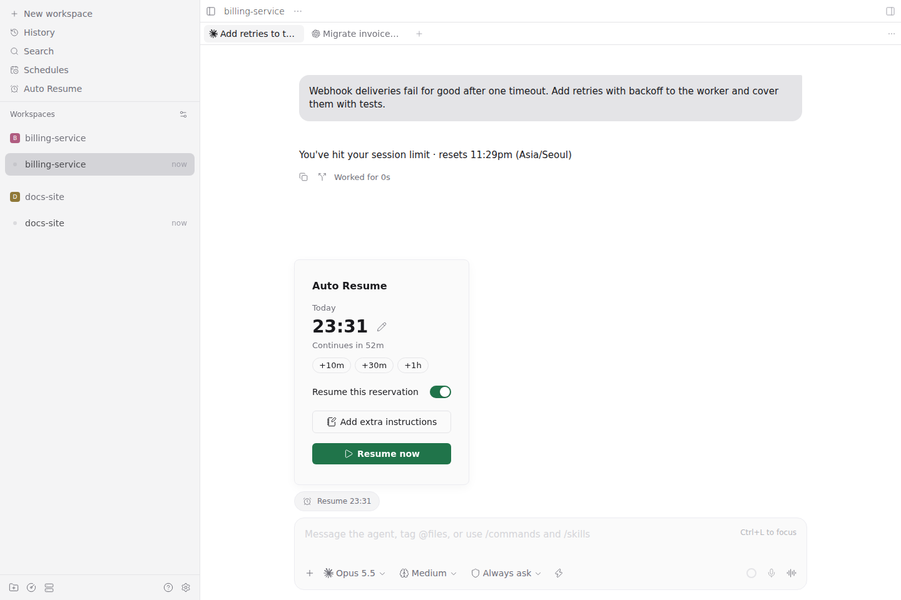
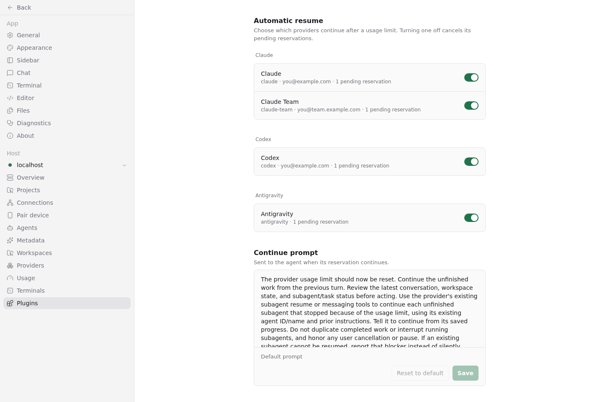

# Usage Auto Resume

**Let Auto Resume handle the wait for usage limits to reset.**

A [Paseo](https://paseo.sh) plugin that automatically asks the same Codex, Claude, or Antigravity agent to continue unfinished work after a usage limit resets. Step away without coming back just to send “continue.”

[한국어](README.ko.md)


Actual Paseo web interface with sample reservations. Each row shows what is scheduled to continue or waiting for verification, and recent activity shows how earlier resumes ended.

- **Pick up in the same conversation.** When a supported agent stops at a usage limit, a resume is scheduled for you.
- **See what comes next.** Check upcoming resumes across providers and workspaces. Reservations survive daemon and plugin restarts.
- **Adjust when you need to.** Skip a resume, move it, add instructions for it, or resume right away.

## Requirements

- **Paseo daemon and app 0.11.0 or later**, with plugins enabled in **Settings → Plugins**.
- The provider CLI already signed in on the daemon host, and the host kept awake.

| Provider | Before sending |
| --- | --- |
| Codex | Checks that your ChatGPT subscription has usage left. |
| Claude | Checks that your claude.ai subscription has usage left. |
| Antigravity | Follows the limit message; usage can't be checked. |

Agents billed through an API key or another billing route are not resumed.

## Install

```bash
paseo plugin install github:babo-jeonguk/paseo-usage-auto-resume
```

## Use

1. Open **Auto Resume** from the sidebar. The list stays empty until an agent hits a usage limit.
2. Keep using your agents as usual. When one stops at its limit, a resume appears in the list.
3. At the scheduled time, the agent is asked to continue in the same conversation.

Sending your own message to the agent, or archiving it, cancels its resume. So does the agent waiting for your permission when the resume is due.

In the list, each resume has:

- **Switch:** turn it off to skip this resume; turn it back on before its time to restore it.
- **+10m / time:** delay it by ten minutes, or select the time to enter another one.
- **Extra instructions:** add something to tell the agent with this continue. They are sent once.
- **Open:** go to the conversation.

The header switch turns every shown resume off or on together. **Recent activity** below the list shows how resumes ended in the last 24 hours.

A conversation with a resume also shows an **Auto Resume** button next to the message box. Use it to manage that resume without leaving the conversation, or select **Resume now** if the limit lifted early.



A resume waiting for verification means the plugin couldn't confirm your account or usage yet; it checks again at the time shown.

## Settings

Open **Settings → Plugins → usage-auto-resume → Settings**.



- **Providers:** turn resumes on or off for each provider, including profiles such as `claude-main` or `codex-sub`. Turning one off cancels its pending resumes.
- **Continue prompt:** see the message sent to the agent and replace it. **Reset to default** brings back the built-in one, which also asks the agent to resume its unfinished subagents.

## Update

```bash
paseo plugin update usage-auto-resume
```

## Remove

```bash
paseo plugin remove usage-auto-resume
```

This also deletes the plugin's settings. Reservations and recent activity stay in `plugin-data/usage-auto-resume` in your Paseo home (`~/.paseo` by default); delete that folder to remove them too.

## Your data

- The plugin reads your agents' state, their recent limit messages and your provider CLI sign-ins on the daemon host.
- Codex and Claude usage checks contact the provider's account service and don't use any model turns. Sign-in tokens are never saved or logged.
- Reservations, extra instructions and a changed continue prompt are stored on the daemon host. Extra instructions are deleted once sent.
- The continue message goes through Paseo to your existing agent, like a message you send yourself.

## More

[Behavior, data access and troubleshooting](docs/behavior.md) has the exact rules. To contribute, see [development and registry submission](docs/development.md). Ideas for more providers and handoffs are in [#3](https://github.com/babo-jeonguk/paseo-usage-auto-resume/issues/3) and [#4](https://github.com/babo-jeonguk/paseo-usage-auto-resume/issues/4).

## Credits and license

[MIT](LICENSE). See [third-party notices](THIRD_PARTY_NOTICES.md). Inspired by [chat-resume](https://github.com/panrafal/paseo-plugins/tree/main/chat-resume), [paseo-continuity](https://github.com/keefeere/paseo-continuity), [paseo-limits](https://github.com/ortschun/paseo-limits) and [paseo-defer](https://github.com/tomgrin10/paseo-defer).
